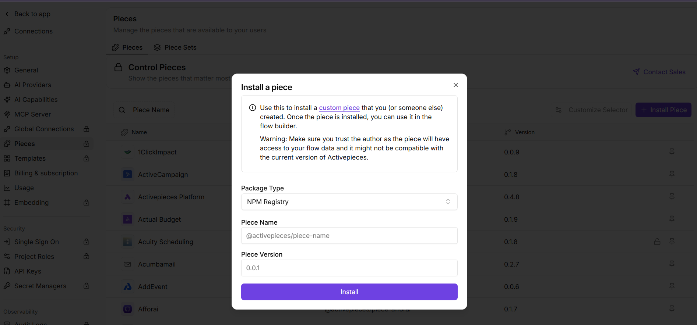

# Seedream Activepieces Piece

本 Piece 通过 Ace Data Cloud 提供 Seedream 动作。Activepieces 0.92.2 及以上版本可由管理员在 **Catalogue → Pieces → Install Piece → NPM Registry** 安装 `@acedatacloud/piece-seedream@0.1.1`。npm 发布不等于进入 Activepieces 官方共享目录。

1. 在 [Ace Data Cloud Applications](https://platform.acedata.cloud/console/applications?utm_source=opensource&utm_medium=referral&utm_campaign=evergreen&utm_content=seedream_activepieces_readme_api_key) 注册或登录。若没有通用应用，点击 **Initialize General Application**。
2. 打开通用应用或具备 **Seedream** 权限的应用。通用 Key 可访问账号已获授权的服务；专用 Key 仅限对应服务。
3. 使用应用卡片的复制按钮，或通过 **Manage Keys → Create** 创建名为 `Activepieces Seedream` 的独立 Key，按需设置有效期与用量限制。若启用 **Allowed APIs**，应同时包含 `/seedream/images` 与 `/seedream/tasks`，创建后复制 Key。
4. 创建 Activepieces 连接，只填写 API Key，不带 `Bearer `。`platform-...` 管理 Token 不是生成 API Key。Key 留在连接中，不写入流程导出；生成前确认服务权限、余额和[当前价格](https://platform.acedata.cloud/models?utm_source=opensource&utm_medium=referral&utm_campaign=evergreen&utm_content=seedream_activepieces_readme_pricing)。
5. [无密钥样例](examples/quickstart.json)选择 **Seedream Generate Image**，用文本提示词生成图片并关闭连续出图，再把任务 ID 映射给 **Seedream Retrieve Task**。两个连接均为空，运行前分别选择自己的连接。创建只运行一次且不自动重试；若返回 pending，只用同一 ID 重复查询。图片编辑与分解是另外的动作，需要参考图。

异步创建只表示任务已受理。保存 `task_id`，用查询动作反复读取同一个任务；仅终态成功后使用 `media_urls`。超时后先查看[请求记录](https://platform.acedata.cloud/console/usages?utm_source=opensource&utm_medium=referral&utm_campaign=evergreen&utm_content=seedream_activepieces_readme_request_history)，避免重复付费。删除/归档需显式确认。

动作列表及公开 API 映射见 [English README](README.md)。源契约参照 [Dify 服务插件](https://github.com/AceDataCloud/SeedreamDify) `f47ac6b322eed59a3bb3ef924ea9fa82ea120ad4`；本 Piece 的源码、npm、实例安装和真实调用分别验收。

API 请求验证 HTTPS 证书，且仅访问 `api.acedata.cloud`。网络失败与 HTTP 错误不自动重试；重新创建前先查请求历史。此传输方式不支持 HTTPS 代理配置。

## 图文配置参考

2026-10-18 复用的真实/官方参考图，[固定来源与边界](docs/screenshots/onboarding-source.json)保留。安装图不是本 Piece 已被官方共享目录收录的证明。管理员安装后按服务名搜索并核对 **by Ace Data Cloud**；Key 只放动作连接。源码 PR、npm 发版、官方目录收录与真实首用分别验收。
